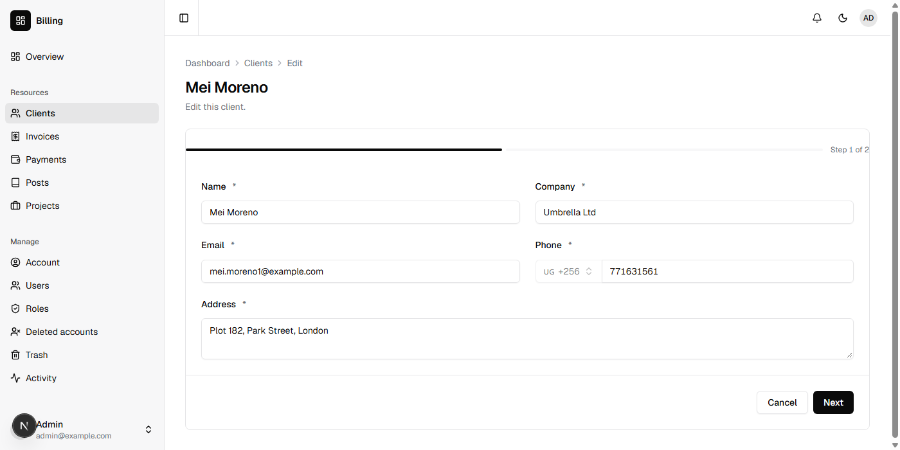
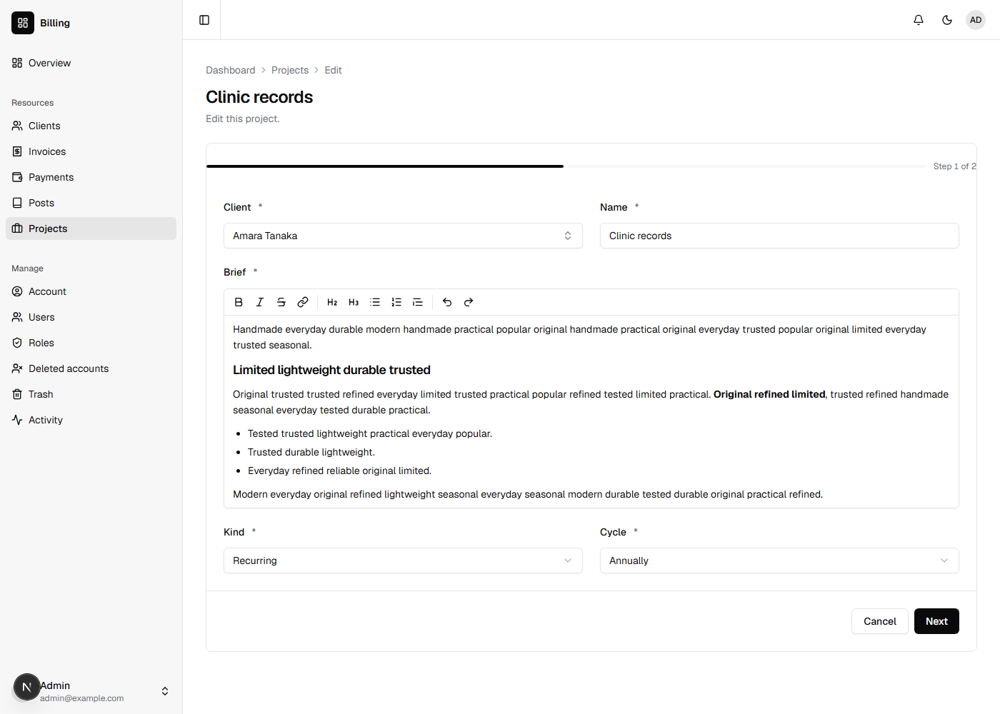
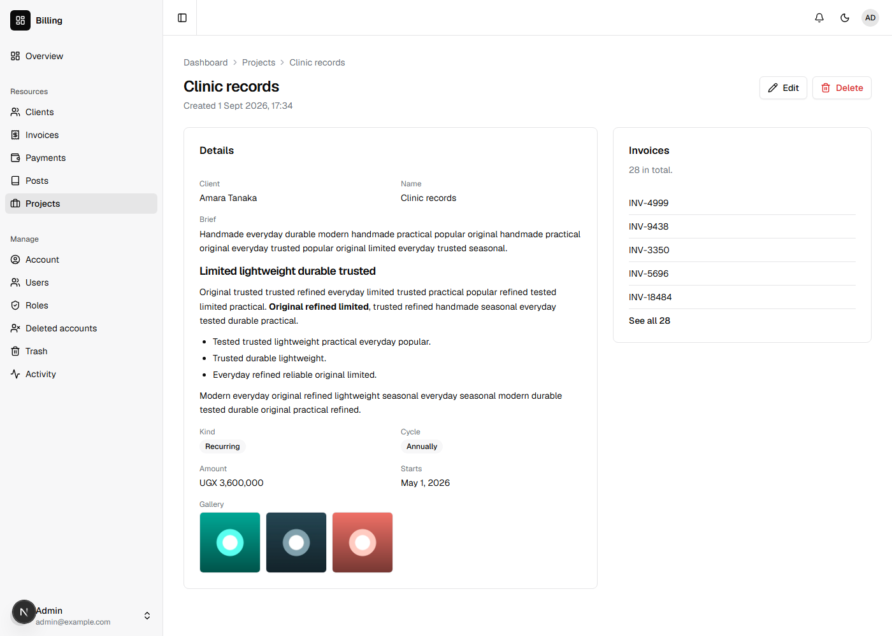
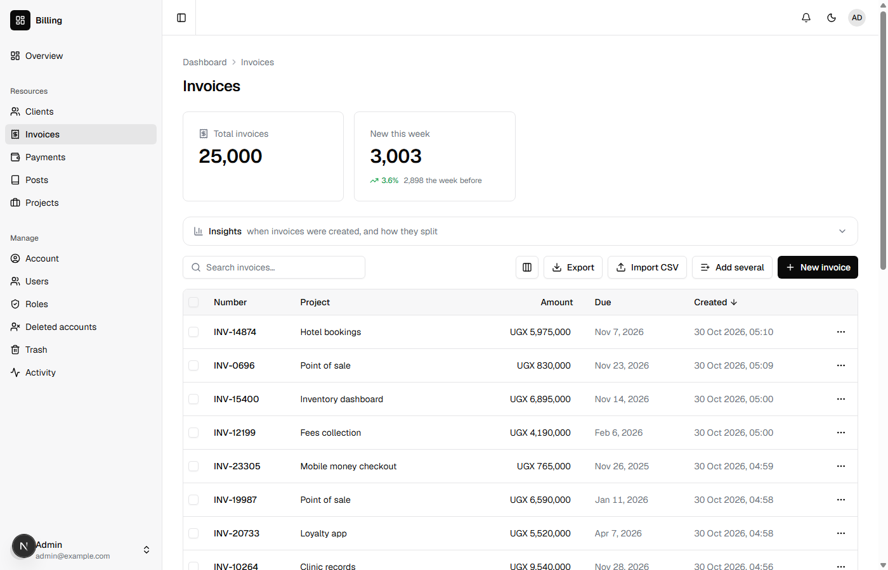

In his GopherCon Africa talk, JB builds a client billing system on stage, from an empty folder, with [Grit](https://gritframework.dev): clients, the projects done for them, the invoices sent and the payments that settle them. Four tables and three relationships, small enough to build in front of a room and real enough to show what every app runs into.

You will build the same app with Nevela, in shillings, and then fill it with as many records as a real business has. It takes about twenty-five minutes.

It goes faster if you have done [Contacts: your first app](/tutorials/contacts/), which explains `nevela resource` and the dashboard. You need what the [quickstart](/start/quickstart/#what-you-need) needs: PHP 8.3 or newer with Composer, and Node.js 20 or newer.

## 1. Create the app, in shillings

```sh
nevela new billing
cd billing
```

Every amount in this app is in Uganda shillings. Say so before making anything: open `apps/api/.env` and add a line at the end.

```ini
NEVELA_CURRENCY=UGX
```

An amount then reads `UGX 4,500,000`, the form takes whole shillings, and the seeder makes amounts in thousands rather than in cents. (The API takes what it is sent; a column holds two decimals whatever the currency.) Any ISO 4217 code works; see [Money and its currency](/concepts/field-types/#money-and-its-currency).

```sh
nevela dev
```

Sign in at http://localhost:3000/sign-in as `admin@example.com` with the password `password`. Run the commands below in a second terminal, in the same folder.

## 2. Clients

```sh
nevela resource Client --fields="name:string, company:string, email:email, phone:tel(UG), address:text, photo:image?" --icon=users
```

A client is a person at a company, with an address and a photo, which is optional (`?`).

`phone:tel(UG)` holds a Ugandan number. It is taken the ways people write one there, `0772 123456`, `772 123456` or `+256 772 123 456`, and kept one way, `+256772123456`, so the same number is always the same. In the form, the country code is fixed at +256. A number from anywhere else is refused: "Enter a Ugandan number, such as 0772 123456 or +256 772 123456." `phone:tel` alone takes any country's. See [Phone numbers](/concepts/field-types/#phone-numbers).



## 3. Projects

```sh
nevela resource Project --fields="client:belongsTo(Client), name:string, brief:richtext, kind:enum(one_off=One-off|recurring), cycle:enum(monthly|annually) if kind == recurring, amount:money, starts:date, gallery:files(image)?" --icon=briefcase
```

A project is done for one client, and has a brief written with headings and lists (`richtext`), an amount, the day it starts, and a gallery of pictures.

A project is either a one-off or recurring. The value stored is `one_off`; `=One-off` is what it is called where people read it, since "One off" is how it would read otherwise.

A billing cycle belongs to a recurring project and means nothing on a one-off one. `if kind == recurring` says so, and both halves of that rule are kept for you:

| A recurring project | A one-off |
|---|---|
| The form shows **Cycle**, marked required. | The form doesn't show it. |
| Saved without one, it is refused: "Needed when the kind is Recurring." | It has none. One sent anyway, from the API or an import, is not kept. |

Change a recurring project to a one-off and its cycle goes with the change. See [A field that only sometimes applies](/concepts/field-types/#a-field-that-only-sometimes-applies).



`gallery:files(image)?` holds up to 20 pictures in the order they were added, each optimised as it arrives. In the form, choose or drop several at once; each shows as a tile you can take out again. See [Several files in one field](/guides/images/#several-files-in-one-field).



## 4. Invoices and payments

```sh
nevela resource Invoice --fields="number:auto(INV), project:belongsTo(Project), amount:money, due:date, notes:text?" --icon=receipt
nevela resource Payment --fields="invoice:belongsTo(Invoice), amount:money, paidOn:date, method:enum(bank|card|cash|mobile=Mobile money), notes:text?" --icon=wallet
```

An invoice is sent for a project, and a payment settles an invoice. Each is a `belongsTo`, so a project's page lists its invoices, and an invoice's page its payments.

`number:auto(INV)` numbers each invoice as it is made, `INV-0001`, `INV-0002` and on, and no two share one. Leave it empty in the form. See [Numbered by Laravel](/concepts/field-types/#numbered-by-laravel).

A payment's method is stored as `mobile` and reads **Mobile money**, in the form, the table, the filters and the export.

## 5. A business's worth of records

A list page that works with twenty records may not with twenty-five thousand. Find out now, not after the app has a year of invoices in it:

```sh
nevela seed Client --count=500
nevela seed Project --count=2000
nevela seed Invoice --count=25000
nevela seed Payment --count=20000
```

Each command says how long it took. The records read like a business's: a client is a person at a company with a Ugandan number, a one-off project has no cycle and a recurring one does, some projects have pictures, invoices are numbered `INV-0001` to `INV-25000`, and amounts are whole shillings. Each invoice is for one of the projects, and each payment for one of the invoices.

Open **Invoices**. The list fetches one page at a time, so the first of 25,000 opens as the first of 25 does. Search for `INV-12345`, sort by the due date, filter by project, and export what you see.



## Coming from Grit

JB's commands, and Nevela's for the same field. Most of Grit's spellings are understood as they are, so you can type what you know:

| Grit | Nevela |
|---|---|
| `client:belongs_to[Client]` | `client:belongsTo(Client)`, or Grit's |
| `kind:select[one_off, recurring]` | `kind:enum(one_off\|recurring)` |
| `mobile="Mobile money"` | `mobile=Mobile money`, inside the brackets |
| `cycle:select[…] if kind == recurring` | `cycle:enum(…) if kind == recurring`, the same condition |
| `phone:tel[UG]` | `phone:tel(UG)`, or Grit's |
| `photo:file[image]` | `photo:image`, or Grit's |
| `gallery:files[image]` | `gallery:files(image)`, or Grit's |
| `number:string:auto:INV` | `number:auto(INV)`, or Grit's |
| `paid_on:date` | `paidOn:date`; the column is `paid_on` either way |
| `--faker`, then `grit seed Invoice --count 25000` | `nevela seed Invoice --count=25000`, or `--seed=25000` on `nevela resource` |

## What you built

- Clients with a Ugandan phone number, kept in one form.
- Projects whose billing cycle applies to recurring ones only, with a written brief and a gallery.
- Numbered invoices, and payments with a method that reads as people say it, all in shillings.
- A dashboard, an API and a database with 47,500 records in them, to see how the app holds up before a real business fills it.

What a client owes is the sum of their invoices less their payments: an [action](/guides/actions/) that sends a client their statement is a good next thing to build. [Seeding](/guides/seeding/) has more on filling an app with records. Before the app goes online, read [Deploying](/guides/deploying/).
