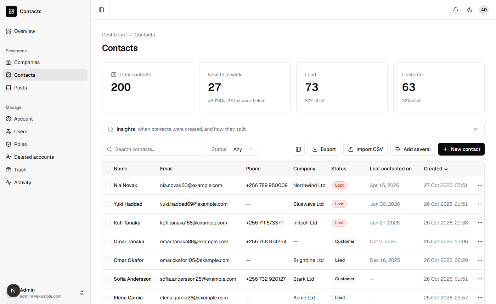
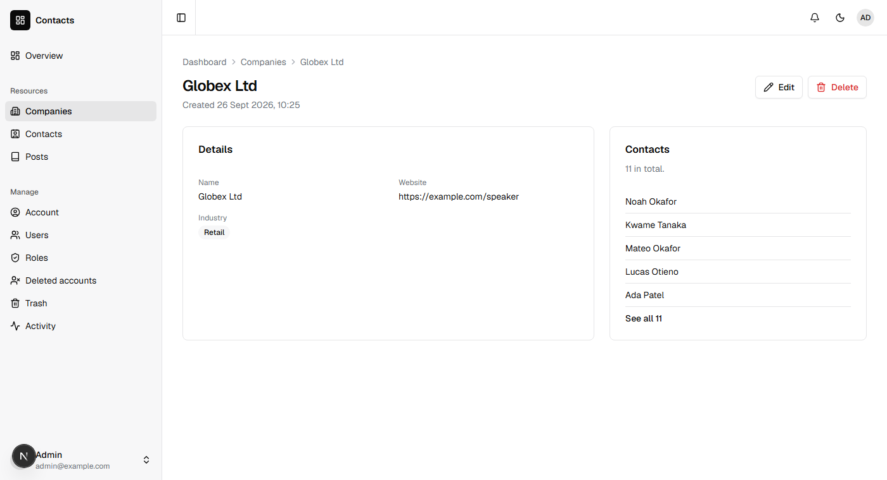
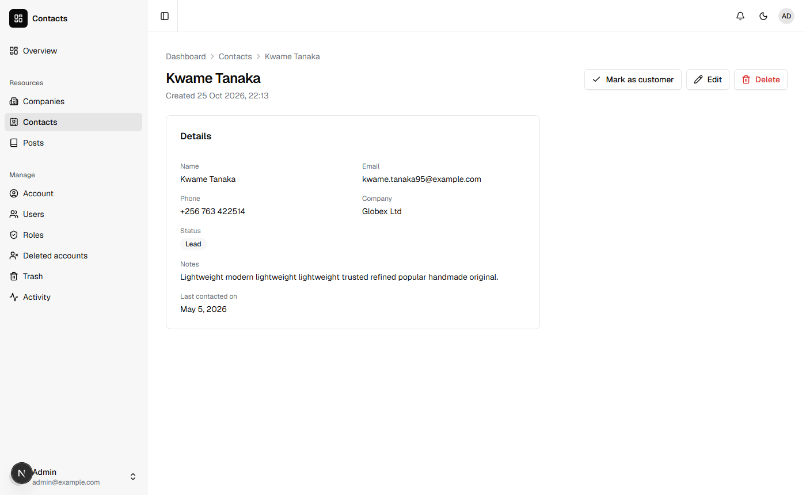

You will build a contacts app: companies, the people at them, and where each person stands, from a lead to a customer. It takes about twenty minutes. Along the way you will use most of what you need for any Nevela app.

You need what the [quickstart](/start/quickstart/#what-you-need) needs: PHP 8.3 or newer with Composer, and Node.js 20 or newer.

## 1. Create the app

```sh
nevela new contacts
cd contacts
nevela dev
```

`nevela dev` runs the Laravel API and the dashboard together. Open http://localhost:3000/sign-in and sign in as `admin@example.com` with the password `password`. The dashboard is empty for now, apart from the blog every new app has.

If you don't have the `nevela` command, install it first with `npm install -g create-nevela`, or see [Without the nevela command](/reference/commands/#without-the-nevela-command).

## 2. Companies

Leave `nevela dev` running and open a second terminal in the same folder.

```sh
nevela resource Company --fields="name:string!, website:url?, industry:enum(software|retail|finance|health|education)?" --icon=building-2 --seed=12
```

Each field is a name and a [type](/concepts/field-types/):

| Field | Meaning |
|---|---|
| `name:string!` | Text. The `!` makes it unique: no two companies share a name. |
| `website:url?` | A web address. The `?` makes it optional. |
| `industry:enum(…)?` | One of a fixed list, optional. |

That one command wrote the Laravel side (a migration, a model, validation, a policy and the API at `/api/companies`) and the dashboard's pages. `--seed=12` made the table and filled it with twelve companies, so there is something to look at. Reload the dashboard: **Companies** is in the sidebar.

## 3. Contacts

```sh
nevela resource Contact --fields="name:string, email:email!, phone:tel?, company:belongsTo(Company)?, status:enum(lead|customer|lost), notes:text?" --icon=contact --seed=200
```

Two fields are new here:

- `company:belongsTo(Company)?` links a contact to one company. In the form it is a picker that searches companies by name. The `?` lets a contact have no company.
- `status:enum(lead|customer|lost)` is required, so every contact has one. Each status gets a count above the table, a badge in it and a filter.



## 4. Look around

Everything here came from the two commands.

- **Search** looks through the text fields, and **Status** filters the list.
- **Insights** opens charts of when contacts were added, and how they split by status. They chart what the list is showing, search and filter included.
- The column button chooses which columns to show. **Export** downloads what you see as a CSV, and **Import CSV** reads one in. **Add several** is a grid for typing in many contacts at once.
- Open a contact for its page. Its company is a link.
- Open a company, and its contacts are listed beside it.



Delete a contact and it goes to the **Trash**, where it waits 30 days and can be restored. **Activity** shows who created, changed and deleted what.

## 5. One more field

You want to know when you last spoke to someone. A new field is added to the resource's descriptor, the JSON file every part was generated from: `apps/api/nevela/resources/contact.json`. Add this inside its `"fields": { … }`:

```json
{
    "lastContactedOn": { "kind": "date", "required": false }
}
```

Then generate again:

```sh
nevela generate Contact
```

The model, the validation, the API and the dashboard's description of a contact now have the field. The table doesn't yet: Nevela writes a table's migration once, because after that the table has your data in it. Make a migration for the column:

```sh
nevela artisan make:migration add_last_contacted_on_to_contacts_table
```

Open the file it made, in `apps/api/database/migrations/`, and make it this:

```php
<?php

use Illuminate\Database\Migrations\Migration;
use Illuminate\Database\Schema\Blueprint;
use Illuminate\Support\Facades\Schema;

return new class extends Migration
{
    public function up(): void
    {
        Schema::table('contacts', function (Blueprint $table) {
            $table->date('last_contacted_on')->nullable();
        });
    }

    public function down(): void
    {
        Schema::table('contacts', function (Blueprint $table) {
            $table->dropColumn('last_contacted_on');
        });
    }
};
```

```sh
nevela migrate
```

Reload: the form has a date picker for it, and the table a column. [Regeneration and your code](/concepts/regeneration/) says what is rewritten and what is yours.

## 6. A button that does something

Turning a lead into a customer is something you will do often. Make it one click. Add an `actions` section to the same descriptor, beside `"fields"`:

```json
{
    "markCustomer": {
        "label": "Mark as customer",
        "icon": "check",
        "confirm": "Mark this contact as a customer?",
        "when": { "status": "lead" },
        "many": true
    }
}
```

- `when` shows the button only on leads, and Laravel refuses it on anyone else.
- `many` lets you select several leads in the table and mark them all at once.

```sh
nevela generate Contact
```

That wrote `apps/api/app/Nevela/Actions/Contact/MarkCustomer.php`, where you say what the button does. It is yours, and is never written over. Make it this:

```php
<?php

namespace App\Nevela\Actions\Contact;

use App\Models\Contact;

class MarkCustomer
{
    public function handle(Contact $contact, array $input): ?string
    {
        $contact->update(['status' => 'customer', 'last_contacted_on' => now()->toDateString()]);

        return "{$contact->name} is a customer now.";
    }
}
```

What it returns is the message the person sees. Open a lead: the button is beside Edit. Press it, and the contact is a customer, contacted today.



[Actions on a record](/guides/actions/) has the rest: actions that ask for something first, and actions on the list as a whole.

## 7. Who may do what

Each resource came with permissions: `contacts.view`, `contacts.create`, `contacts.edit` and `contacts.delete`, and the action added `contacts.mark_customer`. The administrator has them all, and so do the two sample editors. The sample users have none, so Contacts isn't in their sidebar.

Open **Roles** and press **Edit** on USER. Under **Resources**, tick **View** on the Contacts row, and **Save**. The action is there too, under Contacts, as **Mark as customer**.

Sign out, and sign in as `sofia.martinez@example.com` (the same password). Contacts is in her sidebar, and nothing else of yours: no New, no Edit, no Delete, no Mark as customer. Laravel refuses those to her as well, whatever a page shows. Her Company column says **Hidden**: her role doesn't include companies. Tick **View** on Companies as well, and the names are there.

For a rule about the record itself, such as "only the person who added a contact may delete it", write it in `apps/api/app/Policies/ContactPolicy.php`. See [Users, roles and permissions](/guides/policies/).

## 8. The API

The dashboard uses an API you can call from anything: a phone app, a script, another service. Sign in for a token:

```sh
curl -s -X POST http://127.0.0.1:8000/api/auth/token -H "Content-Type: application/json" -H "Accept: application/json" -d '{"email":"admin@example.com","password":"password"}'
```

The answer has a `token`. Send it with every request:

```sh
curl -s -g "http://127.0.0.1:8000/api/contacts?filter[status]=lead&sort=name&perPage=5" -H "Accept: application/json" -H "Authorization: Bearer <token>"
```

That is the first five leads by name, with how many there are in all. [REST API](/reference/api/) has every endpoint, and the same permissions apply there as in the dashboard.

## What you built

- Two resources, linked, each with a table, a form, a page, search, filters, import and export, and an API.
- A field added after the fact, with its migration.
- An action, with its permission and its button.
- Roles that decide who sees what.

Next, [Build a shop](/guides/shop/) adds images that are optimised when they are uploaded, and [Line items](/guides/line-items/) gives a record lines edited in its form, like an order's items. Before you put the app online, read [Deploying](/guides/deploying/).
