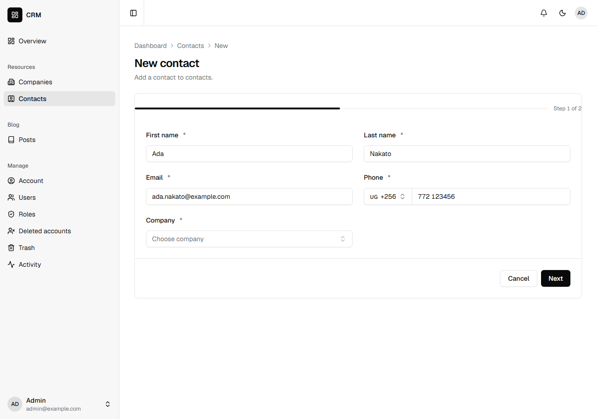
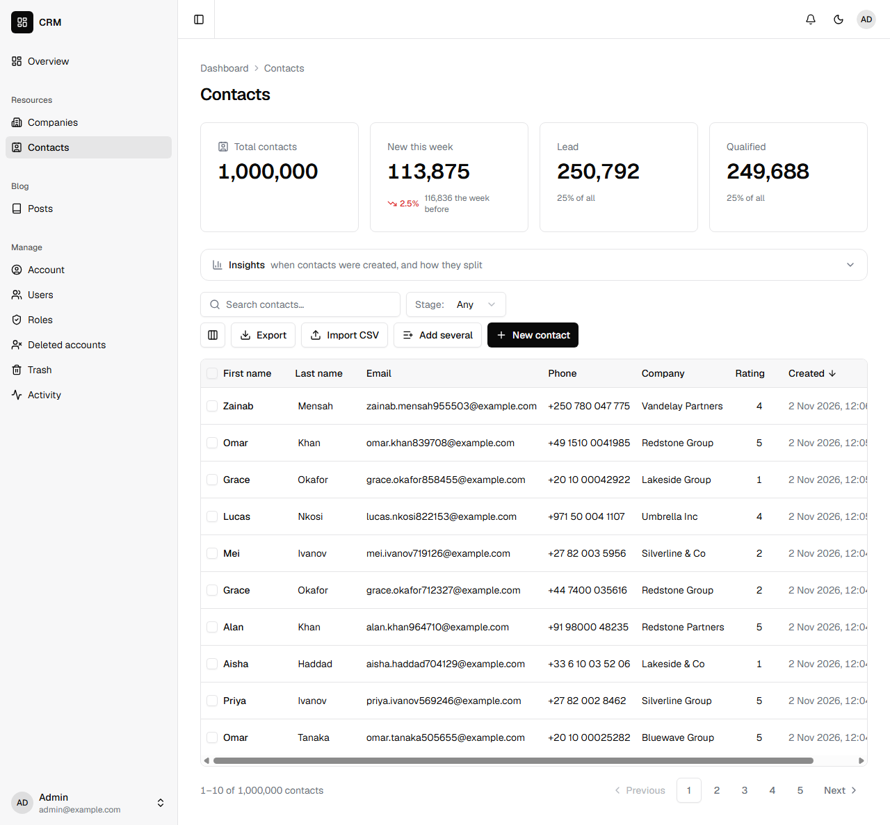

A CRM is mostly ordinary data done right. A contact's phone number has to be real, from any country, and kept one way, so that the same number typed two ways is one number. Nobody should be able to type "blue" for a company's brand colour. And there are a lot of rows, so the test data has to be big enough to show where the app will struggle.

You will build that CRM: companies, and a million contacts at them. [Grit's CRM tutorial](https://gritframework.dev/blog/build-a-crm-with-grit) builds the same app; this is the Nevela way, and [Coming from Grit](#coming-from-grit) maps one to the other. It takes about twenty minutes, and a quarter of an hour of that is the million contacts, which you can stop and start again.

It goes faster if you have done [Contacts: your first app](/tutorials/contacts/), which explains `nevela resource` and the dashboard. You need PHP 8.3 or newer with Composer, and Node.js 20 or newer: [Set up your computer](/start/setup/) says how to get them.

## 1. Create the app, in Uganda

```sh
nevela new crm
cd crm
```

Most of your contacts are in Uganda, so a number written without its country code, `0772 123456`, should be read as a Ugandan one. Say so: open `apps/api/.env` and add a line at the end.

```ini
NEVELA_PHONE_COUNTRY=UG
```

A number that starts with its code, `+44 7400 123456`, is still read as what it says. Without this line, every number needs its `+`.

```sh
nevela dev
```

Sign in at http://localhost:3000/sign-in as `admin@example.com` with the password `password`. Run the commands below in a second terminal, in the same folder.

## 2. Companies

```sh
nevela resource Company --fields="name:string, website:url, domain:domain!, brand:color, country:country(UG), industry:enum(tech=Technology|retail|health|finance), profile:json?" --icon=building-2
```

Each of these fields checks what it is given and keeps it one way, whether it comes from the form, the API, a CSV import or the seeder:

| Field | Type | Kept as | In the dashboard |
|---|---|---|---|
| `website` | `url` | an `http` or `https` address | an address input, and a link in the table |
| `domain` | `domain!` | a bare host in small letters, so a pasted `https://Example.COM/about` is `example.com`, and `münchen.de` is `xn--mnchen-3ya.de` | an input that tidies what is pasted into it. The `!` makes it unique |
| `brand` | `color` | `#aabbcc`, so `#ABC` is `#aabbcc` | a colour picker beside the code, and a swatch in the table |
| `country` | `country(UG)` | a two-letter code, and `UG` when left out | a searchable list of 249 countries |
| `industry` | `enum(…)` | one of the four | a dropdown. `tech=Technology` names the value, as people read it |
| `profile` | `json?` | an object or a list | a box for JSON, which says when what is in it isn't |

See [Field types](/concepts/field-types/) for every one.

## 3. Contacts

```sh
nevela resource Contact --fields="firstName:string, lastName:string, email:email!, phone:tel!, company:belongsTo(Company), rating:rating, bestTime:time, winChance:percent, stage:enum(lead|qualified|customer|lost)" --icon=contact
```

The one to look at is `phone:tel!`.

A phone number is checked against [libphonenumber](https://github.com/google/libphonenumber), Google's record of how numbers look in each country, by the dashboard and by Laravel alike. It is kept as the world writes numbers to each other: a `+`, the country's code and the number, no spaces. So `0772 123456`, typed by a rep in Kampala, and `+256 772 123 456`, pasted from an email signature, are both `+256772123456`, and the `!` can do its job: the same number is the same number.

In the form it is a picker for the country's code, starting at Uganda because of `NEVELA_PHONE_COUNTRY`, beside the number. Type `+44` and the picker changes to the United Kingdom. To take one country's numbers only, write `phone:tel(UG)`. See [Phone numbers](/concepts/field-types/#phone-numbers).

The others:

- `email:email!` is kept in small letters, so `Ada@Example.COM` and `ada@example.com` can't both be there.
- `rating:rating` is a whole number from 1 to 5, set as stars. `rating(10)` gives ten.
- `bestTime:time` is a time of day, kept as `09:05` when `9:05` is sent.
- `winChance:percent` is a number from 0 to 100, shown as `62.5%`.



## 4. A million contacts

Each contact belongs to a company, so make the companies first:

```sh
nevela seed Company --count=1000
nevela seed Contact --count=1000000
```

This is what the second command printed, on a laptop, on SQLite:

```
 1000000/1000000 [============================] 100%

 INFO  Seeded 1,000,000 Contacts in 380.77 s (2,626 rows/s).

  Contacts in the database .......................................... 1,000,000
```

A million contacts in a little over six minutes. Each contact belongs to one of the companies, has its own email and its own phone number, a real one from one of twenty countries, and the rest is what its fields allow.

**It tops up.** `--count` is how many the table should hold, not how many to add. Run the same command again and it says so and does nothing:

```
 INFO  1,000,000 Contacts are there, and you asked for 1,000,000. Nothing to seed.
```

So it is safe to stop. Press Ctrl+C halfway, run the same command again, and it carries on to exactly a million. Rows are saved 5,000 at a time, so stopping loses at most that many.

**Unique values stay unique.** At a million rows, values drawn at random meet each other. The seeder builds each row from its number in the table, so each email and each phone number is its own, and a run carries on from what the table already holds.

**It fails loudly.** A batch that fails stops the run, and says what went wrong and how many were saved.

Open **Contacts**. The list fetches one page at a time, so the first page of a million opens. On the same laptop, with a million, a page of the list came back in under a second, and a search or the counts above the table in about a second and a half. Asking for page 39,000 takes far longer: a list this long is for searching and filtering, not for paging through. If you are going to work at this size, seed it on the database you will run.



## 5. What Laravel keeps of what is sent

The form isn't the only way in. Send a contact over the API the way a person would type one ([The API](/tutorials/contacts/#8-the-api) in Contacts shows how to get a token):

```http
POST /api/contacts
{
  "firstName": "Ada",
  "lastName": "Nakato",
  "email": "Ada.Nakato@Example.COM",
  "phone": "0772 123456",
  "companyId": "…",
  "rating": 4,
  "bestTime": "9:05",
  "winChance": 62.5,
  "stage": "lead"
}
```

It answers 201, with what it kept:

```json
{ "email": "ada.nakato@example.com", "phone": "+256772123456", "bestTime": "09:05", "winChance": 62.5 }
```

A number too short to be one is refused, and the answer says what one is:

```json
{
  "error": "Validation failed.",
  "issues": [{ "path": "phone", "message": "Enter a valid phone number, such as 0772 123456 or +256 772 123456. One from another country starts with its code." }]
}
```

So is the same email in capitals, the same number written another way, and a rating of six. The checks are Laravel's, so they hold for every way in: the form, "Add several", a CSV import, an [action](/guides/actions/), or a client of your own.

## 6. Import, export and print

You didn't write any of this, and it is there for every resource:

- **Export** downloads the list as a CSV, with its search and filters, up to 50,000 rows.
- **Import CSV** reads one in, with a template to fill in. Each row goes through the same checks, so a bad phone number is reported with its row number, rather than stored. Up to 5,000 rows at a time.
- **Print**, on a record's page, puts it on paper or into a PDF.
- **Ticked rows** can be deleted together, exported, or have an action run on them.

## Coming from Grit

Grit's commands, and Nevela's for the same thing:

| Grit | Nevela |
|---|---|
| `grit new crm --triple --next --db sqlite` | `nevela new crm`. SQLite is what a new app starts on |
| `domain:domain:unique` | `domain:domain!`, or Grit's |
| `country:country:UG` | `country:country(UG)`, or Grit's |
| `industry:select[tech=Technology, retail, health, finance]` | `industry:enum(tech=Technology\|retail\|health\|finance)`, or Grit's |
| `phone:tel:UG:unique` | `phone:tel!` with `NEVELA_PHONE_COUNTRY=UG`. Here `phone:tel(UG)`, and Grit's spelling with it, takes Ugandan numbers only |
| `email:email:unique` | `email:email!`, or Grit's |
| `rating:rating:10` | `rating:rating(10)`, or Grit's |
| `best_time:time` | `bestTime:time`; the column is `best_time` either way |
| `--faker --count 50`, then `grit seed Contact --count 1000000` | `nevela seed Contact --count=1000000`, or `--seed=50` on `nevela resource`. Both are how many the table should hold |
| `grit migrate` | Nothing: `nevela resource` runs the migration |

Two things in Grit's tutorial aren't in Nevela yet: the live "who else has this contact open" banner, and `pnpm lint`.

## What you built

- Companies and contacts whose values are checked and kept one way: real phone numbers from any country, emails in small letters, bare domains, colours, times, percentages and ratings.
- A dashboard with an input made for each of them, a picker for a phone's country among them.
- A million contacts, seeded with a command you can stop and run again.
- Import, export, printing and bulk actions you didn't write.

A deal belongs to a contact and moves through stages: `nevela resource Deal --fields="contact:belongsTo(Contact), value:money, stage:enum(open|won|lost)"` is the next thing to add. Then [who may do what](/guides/policies/), and [Deploying](/guides/deploying/) before the app goes online.
