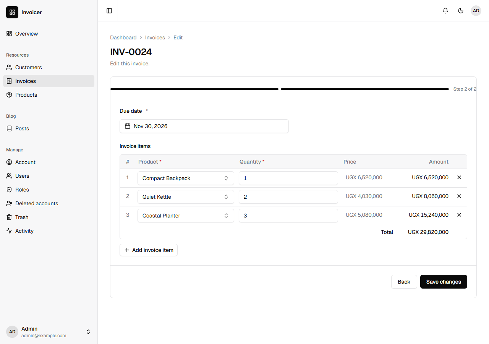
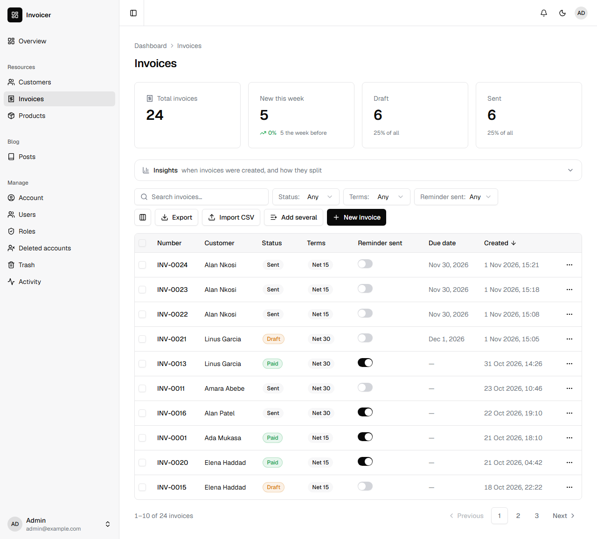
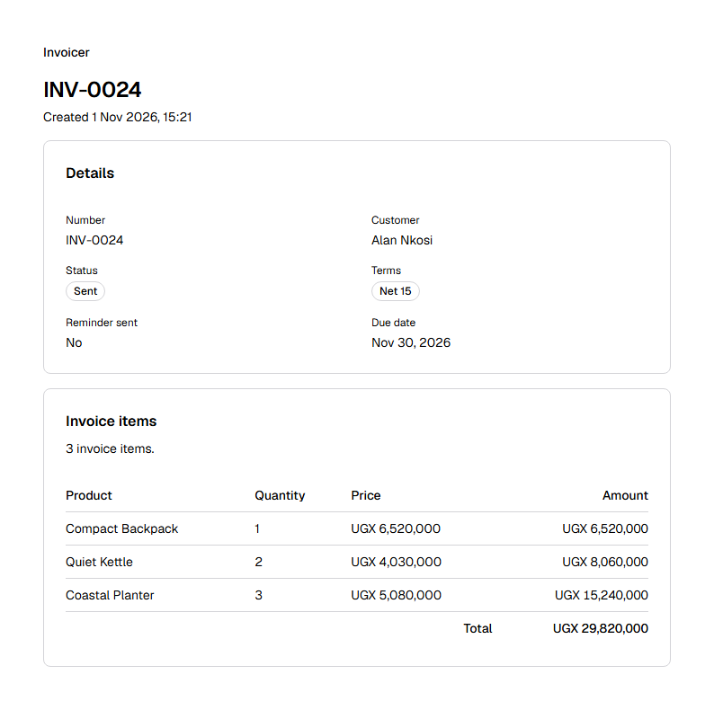

You will build what a small business needs to bill its customers: customers, the products it sells, and invoices made of lines, each one numbered and ready to print. It takes about fifteen minutes. [Grit's invoice tutorial](https://gritframework.dev/blog/build-an-invoice-app-with-grit) builds the same app; this is the Nevela way, and [Coming from Grit](#coming-from-grit) maps one to the other.

This tutorial pulls together things the others teach one at a time. In [the billing app](/tutorials/billing-app/), an invoice has a single amount and is paid by payments. Here it is made of lines, as in [the online shop](/tutorials/online-shop/), and it adds a field later, as in [Contacts](/tutorials/contacts/). You don't need to have done them, though it goes faster if you have. You need PHP 8.3 or newer with Composer, and Node.js 20 or newer: [Set up your computer](/start/setup/) says how to get them, if you haven't yet.

## 1. Create the app

```sh
nevela new invoicer
cd invoicer
```

These invoices are in Uganda shillings. Open `apps/api/.env` and add a line at the end:

```ini
NEVELA_CURRENCY=UGX
```

Any ISO 4217 code works; see [Money and its currency](/concepts/field-types/#money-and-its-currency).

```sh
nevela dev
```

Sign in at http://localhost:3000/sign-in as `admin@example.com` with the password `password`. Run the commands below in a second terminal, in the same folder.

## 2. Customers and products

```sh
nevela resource Customer --fields="name:string, email:email, company:string?" --icon=users --seed=12
nevela resource Product --fields="name:string, price:money" --icon=package --seed=10
```

Each command makes the table, the API and the dashboard's pages, and fills the table with records to work with. The `?` makes a customer's company optional.

## 3. Invoices and their lines

```sh
nevela resource Invoice --fields="number:auto(INV), customer:belongsTo(Customer), status:enum(draft|sent|paid)=draft, terms:enum(net15=Net 15|net30=Net 30)=net30, reminderSent:boolean=false" --items="InvoiceItem: product:belongsTo(Product), quantity:int, price:money(product.price)" --icon=receipt --seed=20
```

That one command is most of the app. Field by field:

- `number:auto(INV)` numbers each invoice as it is made, starting at `INV-0001`. It is left empty in the form.
- `customer:belongsTo(Customer)` is a picker that searches your customers as you type. A customer's page lists their invoices.
- `status:enum(draft|sent|paid)=draft` is a dropdown that starts at Draft. Each status gets a count above the table, a badge in it and a filter.
- `terms:enum(net15=Net 15|net30=Net 30)=net30` is a dropdown too, with labels. `net30` is what is stored and what the API speaks; **Net 30** is what people read, in the form, the table, the filters and the export. A label is optional, and the status above doesn't need one.
- `reminderSent:boolean=false` is a switch that starts off.

`--items` makes the lines: a second resource, InvoiceItem, edited as a table inside the invoice's form and saved with it, or not at all. `price:money(product.price)` copies a line's price from its product, so nobody types it, and a change to the product's price later leaves the invoices already written as they were.

Open **Invoices**, then **New invoice**. Below the fields is a table of lines. Pick a product and its price fills in. Add a line or two: each shows what it comes to, and the table its total, as you type.

The amounts and the total are worked out where they are shown, on the form and on the invoice's page, so they can't disagree with the lines. Nothing is stored, and there's nothing for you to write. If you later want the list of invoices to show and sort by a total, [Keep the total](/tutorials/online-shop/#6-keep-the-total) in the online shop shows how to store one.

## 4. A due date, added afterwards

You have twenty invoices, and now you want each to say when it is due. One command:

```sh
nevela field Invoice dueDate:date
```

It adds the field to the invoice's descriptor, generates the model, the validation, the API and the dashboard again, and adds the column to the table. Reload, and the table has the column.

Press **New invoice** again. Six fields are more than a form puts on one page, so it now has two steps: press **Next** for the due date and the lines.



A due date is required, and your twenty invoices don't have one. They stay as they are, and the form asks for it the next time each is edited. A change that leaves it out, such as marking one paid over the API, still works. New invoices can't be made without one. To see what else it takes, see [`nevela field`](/reference/commands/#nevela-field).



## 5. Numbers nobody shares

An invoice number has to be unique, and an accountant will want no two the same however busy the office is. Two people pressing **Create** at the same moment each get their own: Nevela keeps the last number given in a table of its own, and hands them out one at a time. A number isn't given again, not one in the trash and not one removed for good.

If you type a number in, it is kept, and the next one follows it: type `INV-5000`, and the next one given is `INV-5001`. See [Numbered by Laravel](/concepts/field-types/#numbered-by-laravel).

## 6. Print it

Open an invoice and press **Print**. There is nothing to set up, and every record's page has the button. What goes on paper, or into a PDF if you choose that in the print window, is the app's name, the invoice's fields and its lines with their total, in black on white, without the dashboard around it. A long invoice runs on from page to page with the table's headings on each.



To change what prints, see [Printing a record](/guides/web-app/#printing-a-record). The name at the top is the app's, which you can set under [The app's name and theme](/guides/web-app/#the-apps-name-and-theme).

## Coming from Grit

Grit's commands, and Nevela's for the same thing. Most of Grit's spellings for a field are understood as they are, so you can type what you know:

| Grit | Nevela |
|---|---|
| `grit new invoicer --triple --next` | `nevela new invoicer` |
| `grit g resource Customer --fields "…"` | `nevela resource Customer --fields="…"` |
| `number:string:auto:INV` | `number:auto(INV)`, or Grit's |
| `status:select[draft, sent, paid]` | `status:enum(draft\|sent\|paid)` |
| `terms:select[net_15="Net 15", net_30="Net 30"]` | `terms:enum(net15=Net 15\|net30=Net 30)` |
| `sent:toggle` | `reminderSent:boolean=false` |
| `customer:belongs_to:Customer` | `customer:belongsTo(Customer)`, or Grit's |
| `--items "InvoiceItem:description:string,qty:int,unit_rate:float"` | `--items="InvoiceItem: product:belongsTo(Product), quantity:int, price:money(product.price)"`, or Grit's form with its own fields |
| `grit g field Invoice due_date:date` | `nevela field Invoice dueDate:date`; the column is `due_date` either way |
| `grit migrate` | Nothing: `nevela resource` and `nevela field` run the migration |

In both, a line's amount and the total are worked out as they are shown, and aren't stored. In Grit, an invoice number starts again each month, such as `INV-202607-0001`; in Nevela it counts on, `INV-0001`, `INV-0002`.

## What you built

- Customers and products, and invoices that pick from them with a searchable picker.
- Lines edited as a table inside the invoice and saved with it, each with its product's price, and the amounts and the total as you type.
- A status dropdown, terms with labels and a switch, the same in the form, the API and the export.
- Numbered invoices that are safe when several people are working.
- A due date added after the invoices existed, with one command.
- An invoice ready to print, with nothing to set up.

An [action](/guides/actions/) that marks an invoice sent and emails it is a good next thing to build, and [Who may do what](/guides/policies/) decides who may. Before the app goes online, read [Deploying](/guides/deploying/).
