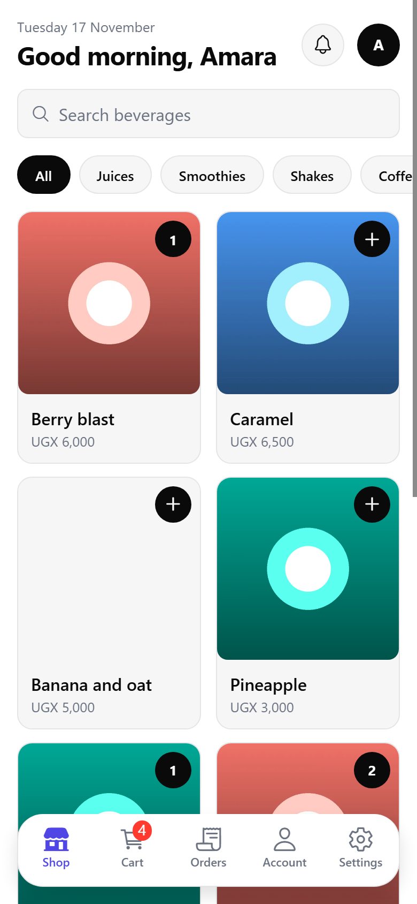
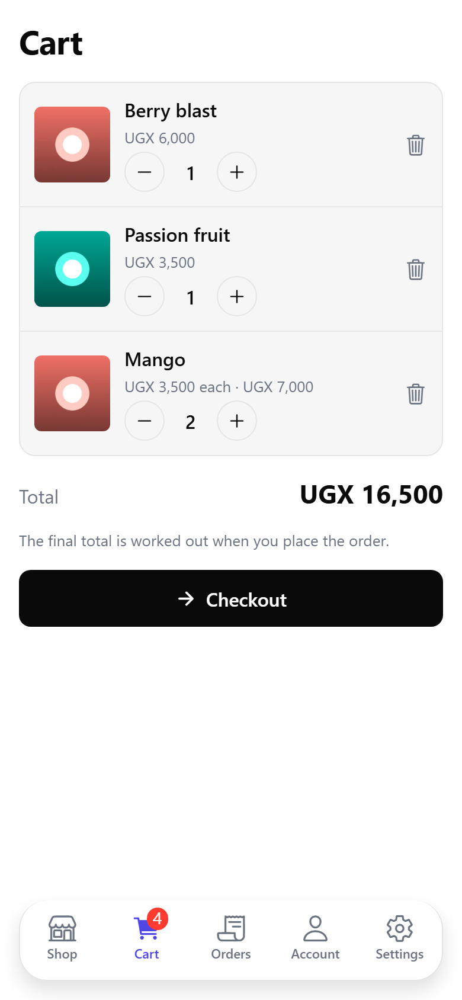
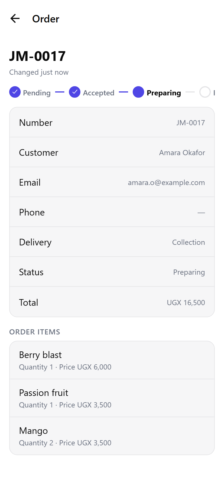

You will build the ordering app of a campus juice bar: customers sign up on their phones, choose drinks, check out and follow their order from Pending to Completed, and the bar's staff accept orders and move them along. There is no mobile code to write. The phone's shop is read from the same resources as the dashboard. It takes about forty minutes.

It goes faster if you have done [An online shop with orders](/tutorials/online-shop/), which explains orders and their items. You need PHP 8.5 or newer with Composer, Node.js 20 or newer, and a phone with [Expo Go](https://expo.dev/go) on the same Wi-Fi as your computer: [Set up your computer](/start/setup/) says how to get the rest.

## 1. Create the app, with a mobile app

```sh
nevela new juice-me --mobile
cd juice-me
```

`--mobile` adds `apps/mobile`, an [Expo](https://expo.dev) app for iOS and Android, beside the dashboard. A bar has prices, and customers who sign themselves up. Open `apps/api/.env` and add these lines at the end:

```ini
NEVELA_CURRENCY=UGX
NEVELA_REGISTRATION=true
NEVELA_DEFAULT_ROLE=CUSTOMER
```

- `NEVELA_CURRENCY` is the currency of every price. Shillings have no decimals, so a drink is `UGX 4,500`.
- `NEVELA_REGISTRATION` lets people make their own account.
- `NEVELA_DEFAULT_ROLE` is the role they start with. Anyone who holds only that role is a **customer**, and gets the customer's app. Everyone else is staff.

```sh
nevela dev
```

## 2. Categories

In a second terminal, in the same folder:

```sh
nevela resource Category --fields="name:string!, image:image?" --icon=tags --seed=4
```

`name:string!` is the category's name, and the `!` makes it unique. `--seed=4` made four, with placeholder pictures.

## 3. Beverages

```sh
nevela resource Beverage --fields="name:string, description:text?, price:money, size:enum(small|medium|large)=medium, image:image(product)?, category:belongsTo(Category), available:boolean=true" --icon=cup-soda --seed=16
```

| Field | What the phone does with it |
|---|---|
| `price:money` | The drink's price, in shillings. |
| `size:enum(small\|medium\|large)=medium` | Shown on the drink's page. A new drink is medium unless you say otherwise. |
| `image:image(product)?` | The picture in the grid, made small by the `product` profile. |
| `category:belongsTo(Category)` | The chips across the top of the shop. |
| `available:boolean=true` | A drink that is out is left off the shelf, and is taken out of a cart that holds it. |

The seeded drinks have invented names and prices, such as a Coastal Bottle at a million shillings. Before going on, open **Categories** and **Beverages** and give them a bar's names and prices: four categories (Juices, Smoothies, Shakes, Coffee), and a few drinks in each, between UGX 3,000 and 6,500. Orders are seeded next, and copy their lines' prices from the drinks as they are then.

## 4. Orders, and whose they are

An order is made of lines: this drink, so many, at this price. It is also somebody's, and once it is placed it is not edited.

```sh
nevela resource Order --fields="number:auto(JM), customer:string, email:email, phone:tel?, delivery:enum(collection|delivery)=collection, details:text?, status:enum(pending|accepted|preparing|ready|completed|cancelled)=pending, total:money?" --items="OrderItem: beverage:belongsTo(Beverage), quantity:int, price:money(beverage.price)" --owner=email --fixed --icon=shopping-bag --seed=12
```

Most of that is as in the online shop: `--items` makes the lines, `number:auto(JM)` numbers each order JM-0001, JM-0002, and `price:money(beverage.price)` copies each line's price from its drink, so the phone never decides what is paid. What is new:

- `status:enum(…)=pending` is the order's journey, in order. The phone shows it as a trail of steps, with the order's step marked. `cancelled` is off the trail: an order that is cancelled didn't get to Completed.
- `delivery` and `details` are what checkout asks: collect it, or bring it, and where or when.
- **`--owner=email`** says whose an order is: the one whose email it holds. That is all it takes for each customer to see only their own orders, and for an order they place to be theirs. Anyone who may edit orders, the bar's staff, sees all of them. [Which records each person sees](/guides/policies/#which-records-each-person-sees) has the rest.
- **`--fixed`** says that once an order is placed, nobody changes it: not its drinks, not its customer, not its total, and nobody deletes it. Not the bar's staff, and not the administrator either. A customer who ordered two mango juices gets two mango juices, or an order that says why it was cancelled. Laravel refuses the change however it is asked, from the dashboard, the phone or anywhere else.

Nobody types the email: when a customer places an order, Laravel puts theirs on it.

## 5. What happens to an order: buttons, not edits

A fixed order moves on in one way: through its actions. Each is a button, with a permission of its own. Open `apps/api/nevela/resources/order.json`, and after the brace that closes `"fields"`, add a comma and this section:

```json
    "actions": {
        "accept": { "label": "Accept", "icon": "check", "when": { "status": "pending" }, "set": { "status": "accepted" } },
        "startPreparing": { "label": "Start preparing", "icon": "cup-soda", "when": { "status": "accepted" }, "set": { "status": "preparing" } },
        "markReady": { "label": "Ready", "icon": "bell", "when": { "status": "preparing" }, "set": { "status": "ready" } },
        "complete": { "label": "Complete", "icon": "check-check", "when": { "status": "ready" }, "set": { "status": "completed" } },
        "cancel": { "label": "Cancel order", "icon": "x", "confirm": "Cancel this order?", "when": { "status": ["pending", "accepted", "preparing", "ready"] }, "set": { "status": "cancelled" }, "fields": { "reason": { "kind": "text", "required": false } } },
        "callOff": { "label": "Cancel with a reason", "icon": "ban", "when": { "status": ["pending", "accepted", "preparing", "ready"] }, "set": { "status": "cancelled" }, "fields": { "reason": { "kind": "text" } } }
    }
```

```sh
nevela generate Order
```

- `when` is where the order has to be for its button to show: **Accept** only on a pending order, and Laravel refuses it on any other. A list is any of them: the bar can cancel an order up to the moment it is ready.
- `set` is what the button does: it moves the status on. That is all these do, so there is no code to write for them.
- **Cancel order** is the customer's, after a question, at any time until the order is completed. A customer who has changed their mind won't collect it anyway. They may say why, and needn't: the reason is `"required": false`.
- **Cancel with a reason** is the bar's. It asks for the reason, and it is required: the customer is told it.

Every press is kept as a step in the order's history: what was done, by whom and when, and the reason. The customer the order belongs to reads it on their phone, and is told of each step as it happens: **Your order JM-0014 is now Accepted**.

## 6. The total, and what only the bar decides

A customer chooses drinks and how many. The total and the order's number are not theirs to choose, and nor is its status, which Laravel keeps for its buttons: a customer's new order is pending, whatever they send. Open `apps/api/app/Models/Order.php`, and under the line `// Your own relationships, scopes and accessors go here`, add the total, as in the online shop:

```php
    /** Called once its items are saved: the order's total is what they come to. */
    public function itemsSaved(): void
    {
        $this->update(['total' => round($this->orderItems()->get()->sum(fn (OrderItem $item) => $item->quantity * $item->price), 2)]);
    }
```

It works out the total in the request that places the order, which a fixed order allows: it is still being made. Below it, what to do with an order a customer makes:

```php
    protected static function booted(): void
    {
        static::creating(function (Order $order): void {
            $user = request()->user();
            if ($user === null || $user->can('orders.edit')) {
                return; // staff, a seeder, the console: whatever they send is kept
            }
            // A customer's order is numbered and priced by Laravel. Whatever the request said
            // for these is ignored: they aren't for the person it helps to choose.
            $order->total = null;
            $order->number = \Nevela\Laravel\Support\Numbering::next($order->getTable(), 'number', 'JM');
        });
    }
```

A customer who sends `"status": "completed"` from their own phone, or a total of `1`, gets an order that is pending and costs what its drinks cost. Staff, who may edit orders, keep what they send when they take an order for someone.

## 7. Customers and staff

Open **Roles** in the dashboard and make two:

| Role | Give it |
|---|---|
| `CUSTOMER` | **View** on Beverages and Categories; **View**, **Create** and **Cancel order** on Orders. |
| `STAFF` | **View**, **Create**, **Edit** and **Delete** on Beverages; the same on Categories except Delete; on Orders, **View** and **Edit**, and **Accept**, **Start preparing**, **Ready**, **Complete** and **Cancel with a reason**. |

On a fixed resource **Edit** edits nothing once a record is made. What it still says is who runs the place: staff see every order, and keep what they send when they take one for someone. The buttons are each given by name, so a customer can cancel their own order and can't accept it. When they cancel, the bar's staff are told, with their reason if they gave one.

Anyone who signs up from the phone is a `CUSTOMER`. The bar's staff are made on the **Users** screen, or:

```sh
nevela user --name="Mercy Auma" --email=mercy@example.com --password=password --role=STAFF
```

You can do the same on the phone, signed in as the administrator: **Account**, then **Roles and permissions** and **People**. Laravel checks all of this on every request. What the phone shows follows from it: a customer has no Records tab, and Mercy, who may edit orders, has the staff app.

## 8. On the phone

```sh
cd apps/mobile
bunx expo start    # npx expo start in an app made with npm
```

Scan the code with Expo Go, on a phone on the same Wi-Fi as your computer. [The mobile app](/guides/mobile-app/) says what to do when the phone can't find the API.

Press **Create an account**, and sign up. The app is a shop: the drinks in a grid with a picture, a size and a price, chips for the categories, and a search box. A customer needs nothing set up for it. The app finds an order resource with lines, and the drinks they are lines of, and builds the shop from them.



Add a few drinks. The cart is kept on the phone, for each account, and a drink that has been taken off the shelf since is taken out of it, with a note. **Checkout** asks how it will get to you, and places the order in one request, with its lines. What comes back is Laravel's: the order's number, and its total.



Open **Orders** for your orders, newest first, and one for where it has got to. Until it is completed, it has a **Cancel order** button, which asks why (you needn't say). There is no **Edit**: the order is what you placed.

## 9. The bar moves it along

In the dashboard, sign in as `admin@example.com` with the password `password`. Open **Orders**: your order is at the top, with all the others. Open it. There is no **Edit** and no **Delete**: there is **Accept**. Press it.

On the phone, a notice is in the bell: **Your order JM-0014 is now Accepted**. Open the order, or pull down to refresh: the trail has moved, and under it the history says **Accept, by Admin**. Move it on with **Start preparing**, **Ready** and **Complete**, as in the picture below. Each is a step in the history, on the phone and on the order's page in the dashboard.



Place another order, and this time, in the dashboard, press **Cancel with a reason** and say why: *Out of mangoes today*. The customer's bell has it, reason and all, and so does the order's history. Mercy can do the same from the phone, signed in with the staff app: an order's buttons are on its page there too.

Sign up a second customer, on a second phone or after signing out of the first. They see an empty Orders tab, and none of yours: Laravel doesn't say another customer's order exists. Their cart is theirs too, and signing out takes it off the phone.

## 10. Continue with Google

Customers can sign up and in with their Google account. It isn't on in this app until you give it a Google client of your own, and Google only sends people back to an https address, so it can't be tried on `http://192.168…`: [From the mobile app](/guides/authentication/#from-the-mobile-app) says what to register with Google and which line to add to `apps/api/.env`. Once the API has it, **Continue with Google** is on the sign-in and sign-up screens, with no change to the app. A customer who signs up this way is a `CUSTOMER` like any other.

## What you built

- A shop on the phone, from four resources, with no mobile code: a grid, a cart, checkout and orders.
- Customers who sign up and are customers, and staff who run the bar, from one set of roles.
- Orders that each belong to their customer, priced and numbered by Laravel, and fixed once placed: nobody edits or deletes one, the administrator included.
- Buttons that move an order on, each a permission of its own, with a history the customer reads and a notice each time it moves.

Everything the phone does goes through the same API as the dashboard, so the rules you set are kept wherever an order is made. From here, [the mobile app](/guides/mobile-app/) says how to change the shop's checkout, and [Sign in with Google](/guides/authentication/#sign-in-with-google) puts a button on the sign-up screen.
