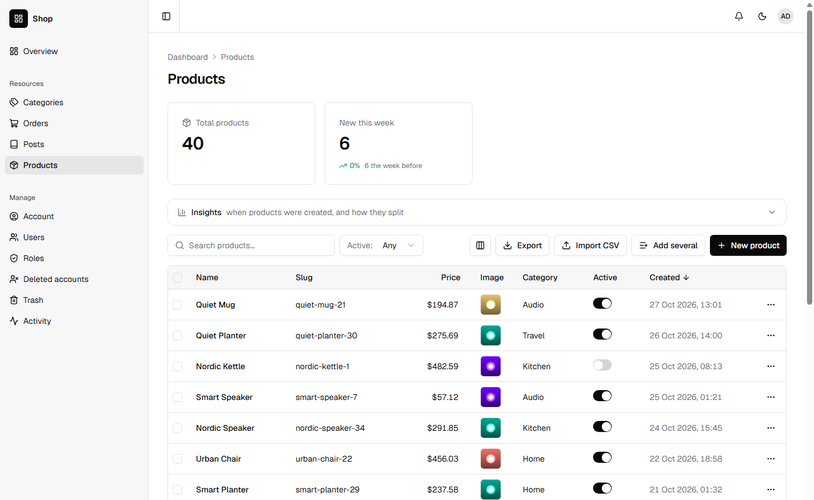
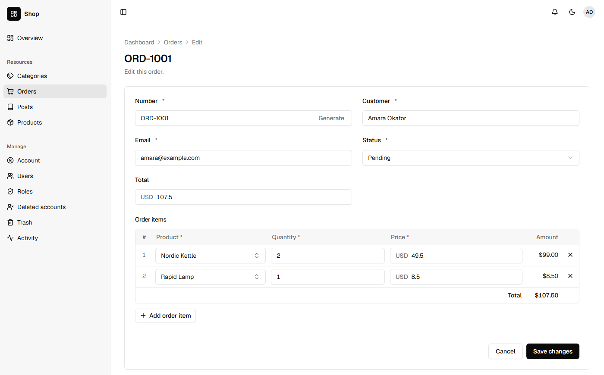
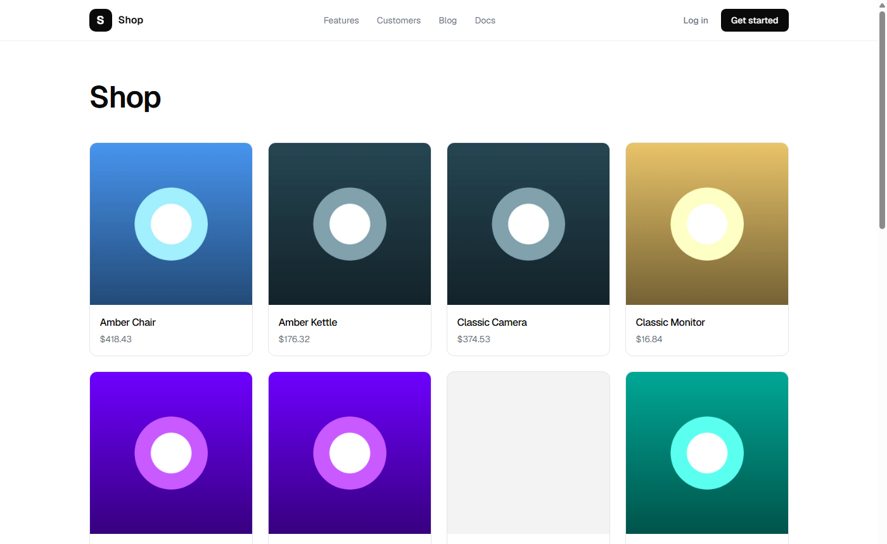

You will build a small shop: categories, products with a picture and a price, orders made of the products in them, and a page anyone can open to see what is on sale. It takes about thirty-five minutes.

It goes faster if you have done [Contacts: your first app](/tutorials/contacts/), which explains `nevela resource` and the dashboard. You need what the [quickstart](/start/quickstart/#what-you-need) needs: PHP 8.3 or newer with Composer, and Node.js 20 or newer.

## 1. Create the app, and its currency

```sh
nevela new shop
cd shop
```

A shop has prices, and a price is in a currency. Say which one before making anything, so every money field takes it. Open `apps/api/.env` and add a line at the end:

```ini
NEVELA_CURRENCY=USD
```

Any ISO 4217 code works: `UGX`, `EUR`, `KES`. Prices are then shown as `$49.50`, or `UGX 45,000`, with the currency's own decimals. A field can have a currency of its own instead; see [Money and its currency](/concepts/field-types/#money-and-its-currency).

```sh
nevela dev
```

Sign in at http://localhost:3000/sign-in as `admin@example.com` with the password `password`.

## 2. Categories

In a second terminal, in the same folder:

```sh
nevela resource Category --fields="name:string!, slug:slug(name)!, image:image?" --icon=tags --seed=8
```

- `slug:slug(name)!` is the category's address on a site, such as `kitchen`. `(name)` makes it from the name when it is left empty, so you never type one. The `!` makes it unique.
- `image:image?` is an optional picture. `--seed=8` made eight categories with placeholder pictures.

## 3. Products

```sh
nevela resource Product --fields="name:string, slug:slug(name)!, price:money, image:image(product)?, category:belongsTo(Category), description:richtext?, active:boolean=true" --icon=package --seed=40
```

Four fields are new here:

| Field | Meaning |
|---|---|
| `price:money` | An amount, in the currency from step 1. The form shows `USD` beside the number, and the table `$49.50`. |
| `image:image(product)?` | A picture made smaller as it is uploaded, by the `product` profile. |
| `description:richtext?` | Text with headings, lists and links, written in an editor. |
| `active:boolean=true` | Whether the product is on sale. `=true` is the default: a new product is on sale unless you say otherwise. |

A product needs a category, so categories came first. Asking for a relation to a resource that doesn't exist yet is refused, with the command to make it.



## 4. Pictures and prices

Open **New product** and drop a photo on the picture field. Laravel turns it the right way up, takes out where it was taken, and keeps a few sizes of it:

| Size | For |
|---|---|
| fits in 1000×1000 | a product's own page |
| 600×600, called `card` | a grid of products |
| 300×300, called `thumb` | the dashboard's table, a cart |

They are WebP files, a fraction of what the photo was. [Files and images](/guides/images/) has the profiles, and how to change the sizes.

The description isn't a column in the table. Long text starts hidden, so the table keeps its shape; the column button above the table turns it on. See [Which columns the table shows](/concepts/field-types/#which-columns-the-table-shows).

## 5. Orders and their items

An order is made of lines: this product, so many, at this price. Lines are a resource of their own, edited inside the order.

```sh
nevela resource Order --fields="number:string!, customer:string, email:email, status:enum(pending|paid|shipped|cancelled)=pending, total:money?" --items="OrderItem: product:belongsTo(Product), quantity:int, price:money" --icon=shopping-cart --seed=20
```

`--items` names the lines and their fields. That made two resources:

- **Order**, with the fields after `--fields`. `=pending` is where a new order starts.
- **OrderItem**, with a product, a quantity and a price, and one more field, `order`, which points each line at its order.

Open an order and press **Edit**. Below its fields is a table with a row for each item. **Add order item** adds a row, and the cross at the end of a row removes it. Each row shows what it comes to, and the table its total, as you type. The order and its items are saved together, or not at all.



Order items aren't in the sidebar: an item is reached through its order. Deleting an order puts its items in the trash with it, and restoring the order brings them back.

## 6. Keep the total

The form shows the total, but nothing stores it yet, so the Orders table can't show or sort by it. Nevela calls a method on the order after its items are saved, if the model has one. Open `apps/api/app/Models/Order.php`, and under the line `// Your own relationships, scopes and accessors go here`, add:

```php
    /** Called once its items are saved: the order's total is what they come to. */
    public function itemsSaved(): void
    {
        $this->update(['total' => round($this->orderItems()->get()->sum(fn (OrderItem $item) => $item->quantity * $item->price), 2)]);
    }
```

`orderItems()` is the relation Nevela wrote for the lines. It runs whenever an order is saved with its items, in the dashboard or with `items` over the API, and in the same transaction, so the total and the items are saved together. Change a quantity in an order and save it: its total in the table follows.

An item changed on its own, through `/api/order-items`, doesn't call it, and its order keeps the old total until the order is next saved. Change items through their order and the total stays right.

The seeded orders were given made-up totals. Each is set right the next time its order is saved. Anything else that follows from the items goes in `itemsSaved()` too: stock, a discount, tax.

The same happens over the API. An order is sent with its items, and comes back with its total:

```json
{
  "number": "ORD-1001",
  "customer": "Amara Okafor",
  "email": "amara@example.com",
  "items": [
    { "productId": "019a…", "quantity": 2, "price": 49.5 },
    { "productId": "019b…", "quantity": 1, "price": 8.5 }
  ]
}
```

Sent to `POST /api/orders`, that is an order of `107.5`. [Line items](/guides/line-items/#in-the-api) says how items are changed and removed over the API.

## 7. Products anyone may see

So far everything is behind sign-in. A shop needs its products seen by anyone. A resource's `"public"` section says what of it is open: it goes in its descriptor, `apps/api/nevela/resources/product.json`, after the brace that closes `"fields"`, with a comma after that brace. The end of the file is then:

```json ins={6-11} mark={5}
        "active": {
            "kind": "boolean",
            "default": true
        }
    },
    "public": {
        "read": {
            "by": "slug",
            "fields": ["name", "slug", "price", "image", "description"]
        }
    }
}
```

- `fields` is everything a visitor can see. The category, whether it is on sale and when it was added stay private.
- `by` fetches one product by its slug: `/api/public/products/quiet-kettle-3` rather than by id.

```sh
nevela generate Product
```

It says that `Product can be read publicly, but its model doesn't say which records may be, so none are.` That is on purpose: which products are public is yours to say, and until you do, none are. Open `apps/api/app/Models/Product.php`, and under the line for your own code, add:

```php
    /** Which products anyone may see: the ones on sale. */
    public function scopePublicQuery(\Illuminate\Database\Eloquent\Builder $query): void
    {
        $query->where('active', true);
    }
```

Try it, with no token:

```sh
curl -s -g "http://127.0.0.1:8000/api/public/products?sort=name&perPage=3" -H "Accept: application/json"
```

Three products on sale, by name, with only those five fields, and `imageFile` beside `image` with the picture's address and sizes. A product that isn't on sale is a 404 here, by slug and by id. Sorting, filtering and search work as on the signed-in list, over the public fields only. [A public site on your API](/guides/public-site/) has the rest, including a form anyone can send.

## 8. A page for the shop

The web app that holds the dashboard also holds your site. Make the file `apps/web/app/shop/page.tsx`:

```tsx
import type { Metadata } from "next";
import { SiteHeader } from "@/components/marketing/site-header";
import { resourceTag } from "@/lib/cache";
import { fileUrl } from "@/lib/files";
import { displayValue } from "@/lib/format";
import { laravelPublic } from "@/lib/laravel";
import Product from "@/resources/product.resource";

export const metadata: Metadata = { title: "Shop" };

type OnSale = { id: string; name: string; slug: string; price: number; image: string | null };

/** Every product on sale, by name: what the products' public section lets anyone read. */
export default async function ShopPage() {
  const response = await laravelPublic("products?sort=name&perPage=48", { tags: [resourceTag("Product")] });
  const products = response.ok ? (response.body as { data: OnSale[] }).data : [];

  return (
    <>
      <SiteHeader />
      <main className="mx-auto max-w-6xl px-6 py-16">
        <h1 className="text-4xl md:text-5xl">Shop</h1>
        {!response.ok ? (
          <p className="mt-12 text-foreground-muted">The shop is unavailable just now. Try again in a moment.</p>
        ) : products.length === 0 ? (
          <p className="mt-12 text-foreground-muted">Nothing is on sale yet.</p>
        ) : (
          <ul className="mt-12 grid gap-6 sm:grid-cols-2 lg:grid-cols-4">
            {products.map((product) => (
              <li key={product.id} className="overflow-hidden rounded-[calc(var(--radius)+4px)] border border-border bg-surface">
                {product.image ? (
                  // eslint-disable-next-line @next/next/no-img-element -- the card size Laravel made when the picture was uploaded
                  
                ) : (
                  <div className="aspect-square w-full bg-foreground/5" />
                )}
                <div className="flex flex-col gap-1 p-4">
                  <h2 className="font-medium">{product.name}</h2>
                  <p className="text-sm text-foreground-muted">{displayValue(Product.fields.price, product.price)}</p>
                </div>
              </li>
            ))}
          </ul>
        )}
      </main>
    </>
  );
}
```

Open http://localhost:3000/shop.



What each part does:

- `laravelPublic()` reads from `/api/public`. It sends no token and nothing about the visitor, so its answer can be cached and shared by everyone who opens the page.
- `tags: [resourceTag("Product")]` names what the page was made from. Save a product in the dashboard and the page is made again at once; a change that didn't go through the dashboard shows within five minutes.
- `fileUrl(product.image, "card")` is the 600×600 size from step 4, not the full picture.
- `displayValue(Product.fields.price, …)` shows the price as the dashboard does, in the currency.

Any page outside `/dashboard` is open to everyone, so nothing else is needed. The blog at `/blog`, which every new app has, is built the same way and is worth reading next to this.

## What you built

- Three resources and a fourth for the lines, with pictures in three sizes and prices in a currency.
- Orders whose items are edited inside them, saved together, with a total the app keeps.
- A public part of the API, open only as far as you said.
- A page of the products on sale, cached and kept fresh.

From here, a product page at `/shop/[slug]` reads `products/<slug>` the same way, and [Protecting a public form](/guides/protecting-forms/) is the place to start if visitors are to send orders themselves. Before you put the shop online, read [Deploying](/guides/deploying/).
