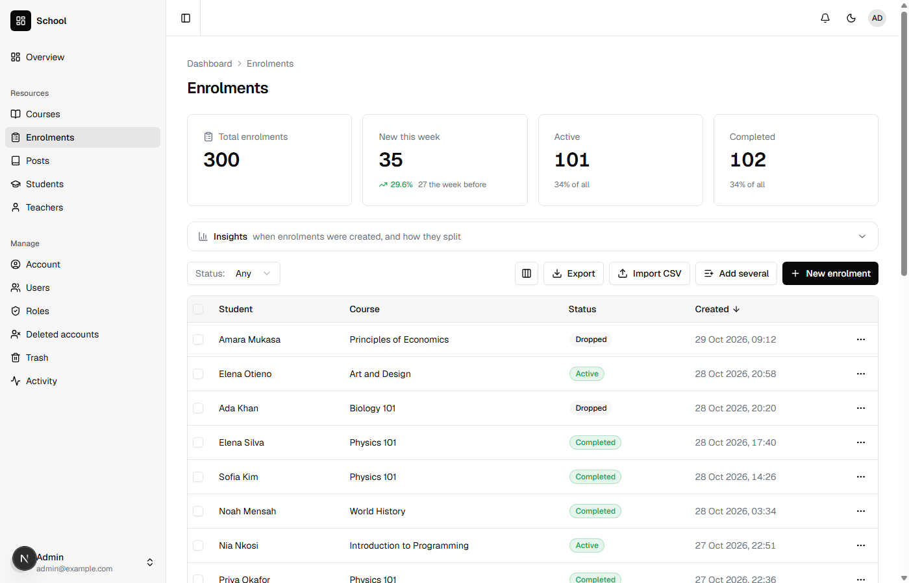
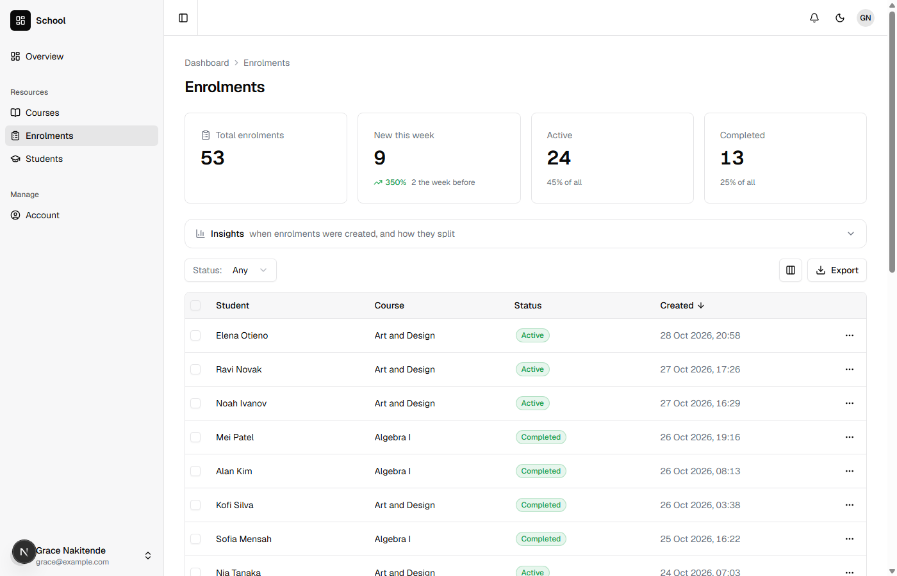
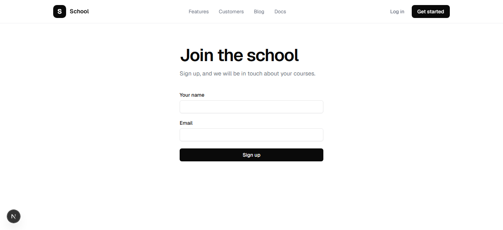
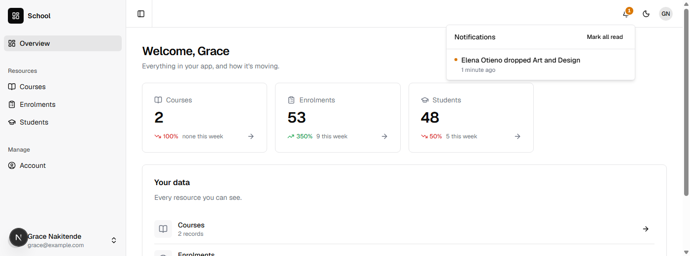

You will build a school's app: teachers, the courses they teach, students, and the enrolments that put a student in a course. Teachers sign in and see their own classes and nothing else. Students sign themselves up on the site, and their address is proved before they count. When one drops a course, the teacher hears of it. It takes about forty-five minutes.

It builds on [Contacts](/tutorials/contacts/) and [An online shop](/tutorials/online-shop/): `nevela resource`, relations, a descriptor's `public` section and code of your own in a model are used here without being explained again. You need PHP 8.3 or newer with Composer, and Node.js 20 or newer: [Set up your computer](/start/setup/) says how to get them, if you haven't yet.

## 1. Create the app

```sh
nevela new school
cd school
nevela dev
```

Sign in at http://localhost:3000/sign-in as `admin@example.com` with the password `password`. Run the commands below in a second terminal, in the same folder.

## 2. Teachers

```sh
nevela resource Teacher --fields="name:string, email:email!, subject:string?" --icon=user --seed=6
```

A teacher's `email` is unique (`!`). It is also how the app knows which teacher has signed in: in step 6, a teacher's account is the user with the same address.

## 3. Courses

```sh
nevela resource Course --fields="title:string, code:string!, teacher:belongsTo(Teacher), description:text?" --icon=book-open --seed=12
```

Each course has one teacher. A teacher has many courses: the Teachers page doesn't show them, but the teacher's model has a `courses()` relation, and a course's form has a picker for its teacher.

## 4. Students

```sh
nevela resource Student --fields="name:string, email:email!, number:auto(STU), dateOfBirth:date?" --icon=graduation-cap --seed=120
```

`number:auto(STU)` gives each student the next number, STU-0001 and on, however the student is added: in the dashboard, by an import, or by the form in step 8.

## 5. Enrolments: students and courses, many to many

A student takes several courses, and a course has many students. That is many-to-many, and the link between the two is a resource of its own: an enrolment is one student in one course, and has things of its own to say, such as how it is going.

```sh
nevela resource Enrolment --fields="student:belongsTo(Student), course:belongsTo(Course), status:enum(active|completed|dropped)=active" --unique=student,course --icon=clipboard --seed=300
```

`--unique=student,course` says a student is in a course once. The two may each be in other enrolments: the student in other courses, the course with other students. The pair is what can't repeat:

- The table has a unique index on the two, so the database refuses a second however it is made.
- The form refuses it with a message, under **Student**: "There is already an enrolment with this student and course." So does the API, and an import says which row.
- The 300 seeded enrolments are 300 different pairs. Ask for more than there are and the seeder says how many there is room for.
- An enrolment in the trash still holds its pair. Restore it, rather than making it again.

In the descriptor, `apps/api/nevela/resources/enrolment.json`, it is written as:

```json
"unique": [["studentId", "courseId"]]
```

Open **Enrolments**. Each row names its student and its course, and the cards count them by status.



[Many-to-many](/guides/relationships/#many-to-many) has more, including a `courses()` relation of your own on a student that goes through the enrolments.

## 6. A teacher who signs in

A teacher signs in to see their classes. They need a role that lets them see courses, students and enrolments, and change an enrolment's status, and nothing more.

Open **Roles** and press **New role**. Call it `TEACHER`, and tick:

| Row | Tick |
|---|---|
| Courses | **View** |
| Students | **View** |
| Enrolments | **View** and **Edit** |

and **Save**. Then make Grace an account with that role, with the password `password` like the sample users:

```sh
nevela user --name="Grace Nakitende" --email=grace@example.com --password=password --role=TEACHER
```

And make her a teacher: open **Teachers**, press **New teacher**, and save her name, Grace Nakitende, and her address, `grace@example.com`. Then open two courses, press **Edit**, and choose Grace as their teacher.

Sign out, and sign in as `grace@example.com`. She has Courses, Students and Enrolments, and every course of the school's is in her list, with every student. The role decides what she may do. Which records she may do it to is the next step.

## 7. Only her own classes

Which records someone sees is the model's to say, in a scope called `visibleTo`. Nevela asks it wherever records reach someone signed in. Four short pieces, each under the line `// Your own relationships, scopes and accessors go here` in its model.

The teacher someone is, by their address, in `apps/api/app/Models/Teacher.php`:

```php
    /** The teacher someone signs in as: the one with their email, if they teach. */
    public static function of(User $user): ?self
    {
        return static::query()->where('email', $user->email)->first();
    }
```

A teacher's courses, in `apps/api/app/Models/Course.php`:

```php
    /** Which courses someone sees: a teacher, their own. Anyone else who may see courses, all of them. */
    public function scopeVisibleTo(\Illuminate\Database\Eloquent\Builder $query, User $user): void
    {
        if ($teacher = Teacher::of($user)) {
            $query->where('teacher_id', $teacher->id);
        }
    }
```

The enrolments in those courses, in `apps/api/app/Models/Enrolment.php`. `whereHas` uses the course's own scope, so the rule is written once:

```php
    /** Which enrolments someone sees: a teacher, the ones in their courses. */
    public function scopeVisibleTo(\Illuminate\Database\Eloquent\Builder $query, User $user): void
    {
        if (Teacher::of($user)) {
            $query->whereHas('course', fn ($course) => $course->visibleTo($user));
        }
    }
```

And the students in those enrolments, in `apps/api/app/Models/Student.php`:

```php
    /** Which students someone sees: a teacher, the ones enrolled in their courses. */
    public function scopeVisibleTo(\Illuminate\Database\Eloquent\Builder $query, User $user): void
    {
        if (Teacher::of($user)) {
            $query->whereHas('enrolments', fn ($enrolment) => $enrolment->visibleTo($user));
        }
    }
```

Reload Grace's dashboard. Courses has her two. Enrolments has the students in them, and Students those students. The counts above each table, the charts and an export count only those, and a course's teacher picker, an enrolment's student picker, offer only what she can see.



It isn't only what the pages show. Laravel answers the API the same way:

- Another teacher's course, opened by its address or asked for by id, is a **404**, as if it weren't there. "Not allowed" would say it exists.
- An enrolment can't be moved into a course she can't see, by sending that course's id. It is refused as an id that doesn't exist is.
- The trash holds only what she could see, and the bell tells her only of those: an administrator adding enrolments to her courses is told to her, and the rest isn't.

The administrator isn't a teacher, so `Teacher::of()` finds nobody and nothing is narrowed: everything is there. [Which records each person sees](/guides/policies/#which-records-each-person-sees) has the whole list, and the two things it doesn't narrow.

## 8. Students who sign themselves up

A student shouldn't need someone to type them in. Open the students to the site, for creating only. In `apps/api/nevela/resources/student.json`, after the brace that closes `"fields"`, with a comma after that brace, add:

```json
    "public": {
        "create": {
            "fields": ["name", "email"],
            "confirm": "email",
            "protect": { "honeypot": true, "minSeconds": 3 }
        }
    }
```

- `fields` is what a visitor may send. The number is given by Laravel, and nothing else can be sent.
- `confirm` proves the address. The student is saved unconfirmed, and a link is emailed to them. Until they follow it they aren't counted, exported or told of, and after two days they are removed. Signing someone else up sends them one email, however many times it is done.
- `protect` keeps out the simplest bots: a field no person sees, and a form sent back faster than anyone could fill it in. [Protecting a public form](/guides/protecting-forms/) has Cloudflare's robot check too, for a form that is live.

```sh
nevela generate Student
nevela migrate
```

The migration gives students a `confirmed_at`, and marks the 120 there already as confirmed: they were students before anyone was asked.

The page: two files in a new folder, `apps/web/app/join`. The page itself, `page.tsx`:

```tsx
import type { Metadata } from "next";
import { SiteHeader } from "@/components/marketing/site-header";
import { JoinForm } from "./join-form";

export const metadata: Metadata = { title: "Join" };

/** Where a student signs up: the students' public form, with their address proved by email. */
export default function JoinPage() {
  return (
    <>
      <SiteHeader />
      <main className="mx-auto max-w-md px-6 py-16">
        <h1 className="text-4xl md:text-5xl">Join the school</h1>
        <p className="mt-4 text-foreground-muted">Sign up, and we will be in touch about your courses.</p>
        <JoinForm />
      </main>
    </>
  );
}
```

And the form, `join-form.tsx`:

```tsx
"use client";

import { PublicFormGuard } from "@/components/public-form-guard";
import { Button } from "@/components/ui/button";
import { Input } from "@/components/ui/input";
import { Label } from "@/components/ui/label";
import { usePublicForm } from "@/hooks/use-public-form";

/** The form itself: sent to /api/public/students, which saves the student unconfirmed and emails a link. */
export function JoinForm() {
  const form = usePublicForm("students");

  if (form.sent) {
    return <p className="mt-10 rounded-lg border border-border p-4">Thank you. We have emailed you a link: follow it to confirm your address.</p>;
  }

  return (
    <form onSubmit={form.submit} className="mt-10 flex flex-col gap-5">
      <div className="flex flex-col gap-2">
        <Label htmlFor="name">Your name</Label>
        <Input id="name" name="name" autoComplete="name" required aria-invalid={Boolean(form.errors.name)} />
        {form.errors.name && <p className="text-sm text-destructive">{form.errors.name}</p>}
      </div>
      <div className="flex flex-col gap-2">
        <Label htmlFor="email">Email</Label>
        <Input id="email" name="email" type="email" autoComplete="email" required aria-invalid={Boolean(form.errors.email)} />
        {form.errors.email && <p className="text-sm text-destructive">{form.errors.email}</p>}
      </div>
      <PublicFormGuard form={form} />
      {form.error && <p className="text-sm text-destructive">{form.error}</p>}
      <Button type="submit" disabled={form.pending}>
        {form.pending ? "Sending…" : "Sign up"}
      </Button>
    </form>
  );
}
```

`usePublicForm("students")` sends the form to `/api/public/students`, with the token that says when the form was handed out, and puts what Laravel says about a field under that field. `<PublicFormGuard>` is the hidden field.

Open http://localhost:3000/join in a private window, sign up, and wait a moment: a form sent back within three seconds is quietly dropped. The page thanks you.



While you build, mail goes to the log, not to anyone; `nevela dev` sends it there. The link is near the end of `apps/api/storage/logs/laravel.log`, in the email's button: the address after `href="`, beginning `http://localhost:3000/confirm`. It is written as HTML, so change each `&amp;` in it to `&` before opening it. A tool that catches mail while you build, such as [Mailpit](https://mailpit.axllent.org/), shows the email with a button to press instead.

The page says **You're confirmed**. Back in the administrator's dashboard, the bell says **Student confirmed**, with the name. Students has them, with the next number. Until the link was followed they were in the table marked **Not confirmed**, and nobody was told.

Grace isn't told: the new student is in none of her courses yet. Enrol them in one of hers and she is.

## 9. Telling the teacher

Nevela tells people when records are created, deleted or restored, but not when one is changed, so that fixing a typo doesn't ring anyone's bell. A student dropping a course is a change worth hearing of, and it is the teacher who should hear. In `apps/api/app/Models/Enrolment.php`, under the line for your own code:

```php
    /** A student who drops a course: their teacher is told, in the bell. */
    protected static function booted(): void
    {
        static::updated(function (Enrolment $enrolment) {
            if (! $enrolment->wasChanged('status') || $enrolment->status !== 'dropped') {
                return;
            }
            $teacher = User::query()->where('email', $enrolment->course->teacher->email)->first();
            if ($teacher !== null) {
                \Nevela\Laravel\Notices\Notices::send($teacher, new \Nevela\Laravel\Notices\Notice(
                    "{$enrolment->student->name} dropped {$enrolment->course->title}",
                    url: "/dashboard/enrolments/{$enrolment->id}",
                    tone: 'warning',
                ));
            }
        });
    }
```

As the administrator, open an enrolment in one of Grace's courses, set its status to **dropped** and save. Sign in as Grace: her bell is coloured, and says who dropped which course. Opening it goes to the enrolment.



It is on the model, so it runs however the status changes: the form, the API, an import, or your own code. `Notices::send()` tells the people you give it. `Notices::toPermission()` tells everyone who may do something instead. [Notifications](/guides/notifications/#sending-your-own) has the rest.

## What you built

- Teachers, courses and students, and enrolments that join students and courses, each pair once.
- A role for teachers, and a rule in each model that keeps a teacher to their own classes: in the pages, the API, the counts, the trash and the bell.
- A sign-up page whose students count only once their address is proved.
- A teacher told, in the bell, when a student drops one of their courses.

Grace can't see the teachers, so her courses' **Teacher** column says **Hidden**. Give the role **View** on Teachers to show it, with a `visibleTo` on Teacher if she should see only herself. Before the school goes online, read [Deploying](/guides/deploying/), and set up mail there, so the links reach the students.
